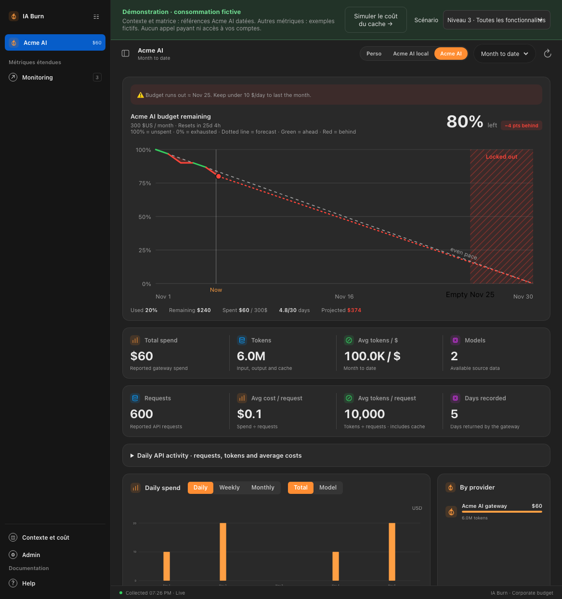
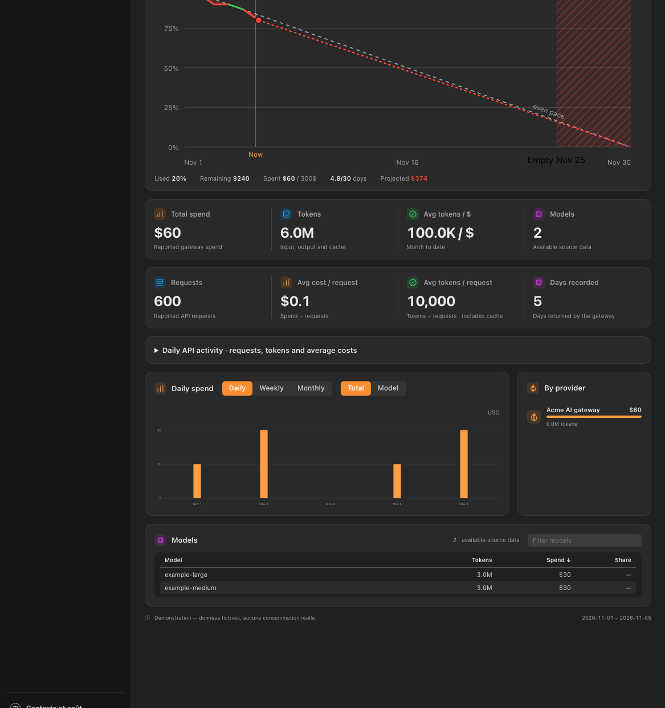
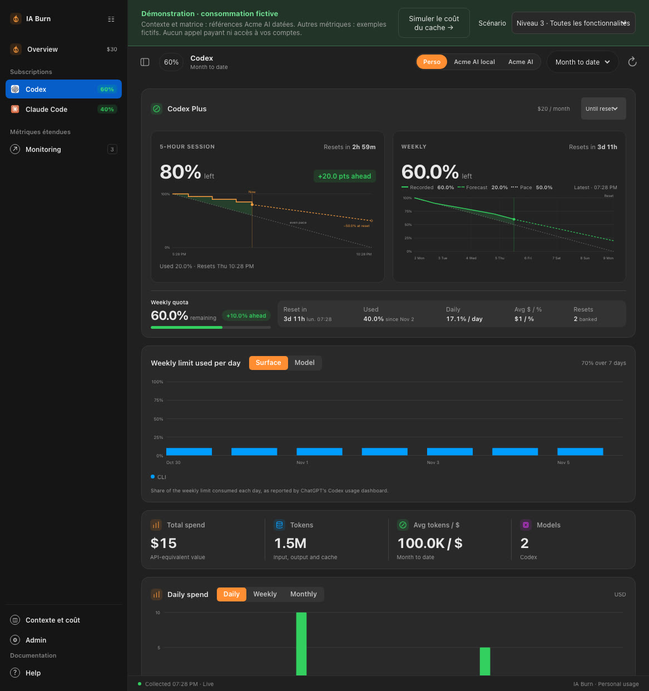
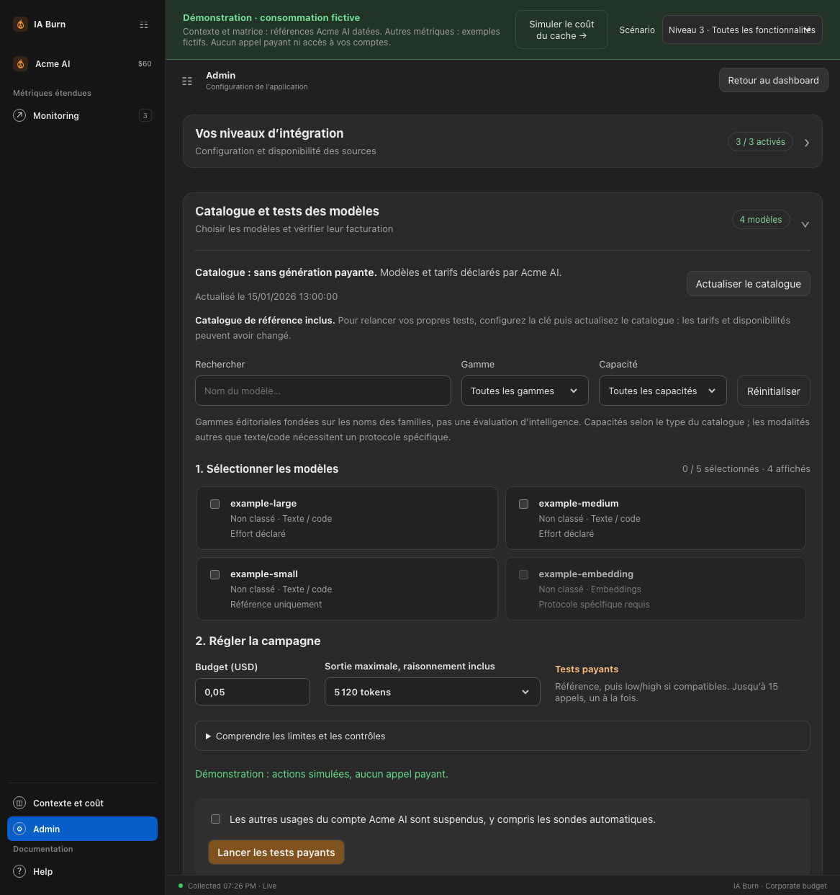
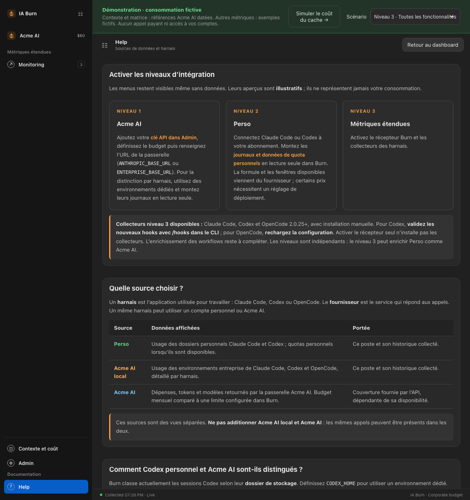

# IA Burn

Dashboard de consommation IA : **budget Enterprise**, dépenses, tokens, requêtes
et répartition par modèle. Une seule image Docker sert le frontend et le backend,
avec un historique SQLite persistant.

## Installation

Prérequis : **Git, Docker et Docker Compose v2**. macOS/Linux, ou Windows via WSL.
La source Enterprise nécessite `ENTERPRISE_BASE_URL` (ou `ANTHROPIC_BASE_URL`) ; sans URL, elle est simplement désactivée.

```bash
git clone <url-du-dépôt> ia-burn
cd ia-burn
./deploy.sh
```

Ouvrir **http://localhost:4090**. Pour un autre port : `./deploy.sh --port 4095`.
Le script crée `.env` si nécessaire et conserve le volume de données.

## Mesures de référence incluses

La matrice **modèles × effort × coût** est livrée avec un **exemple fictif**
(`backend/data/model-calibration-reference.json` : 4 modèles génériques, prix inventés),
visible dans Admin dès le lancement, sans clé ni test payant. **Remplacez-le** par
l’export de votre propre passerelle (`scripts/export-calibration-reference.mjs`,
voir [MODEL-CALIBRATION](docs/MODEL-CALIBRATION.md)).
Ce sont les coûts d’un scénario synthétique commun, pas un tarif fixe par effort
ni une mesure de qualité. La date et l’origine « Référence partagée » sont affichées.

Vos propres tests restent locaux et ont priorité. Pour vérifier les valeurs à
nouveau, configurez votre clé, **actualisez le catalogue**, puis lancez les tests
dans Admin. Les prix et la disponibilité peuvent évoluer. Aucun relevé de compte
ni consommation personnelle n’est inclus dans cette référence.

## Configuration

Ouvrir **Admin** en bas du menu pour enregistrer la **clé API Enterprise**, le budget
mensuel et les fréquences de collecte. La clé est chiffrée dans le volume Docker ;
Admin reste accessible uniquement via localhost. Le nom affiché de la source vient de `ENTERPRISE_LABEL`
(défaut « Enterprise »).

Choisir la source :

- **Enterprise** : montants rapportés par la passerelle, budget et modèles.
- **Enterprise local** : journaux de ce poste, répartis par harnais.
- **Perso** : usage et quotas des comptes personnels.

Les sources API et locale peuvent couvrir les mêmes appels : **ne pas additionner
leurs montants**. Le budget configuré dans Burn sert au suivi et aux prévisions ;
il ne modifie pas celui de la passerelle.

### Exemple : configurer une entreprise (Acme Corp)

[`examples/acme.env`](examples/acme.env) remplit toutes les variables `ENTERPRISE_*` pour une
entreprise fictive, *Acme Corp*, dont la passerelle s’appelle « Acme AI »
(`https://ai-gateway.acme.example`, jeton factice). Copier les lignes utiles dans `.env`,
puis remplacer URL et jeton par ceux de votre passerelle. Sans `ENTERPRISE_BASE_URL`, la source
reste désactivée. La démonstration statique affiche cette même source « Acme AI ».

## Trois niveaux d’intégration

Les niveaux sont **indépendants et complémentaires** : activez ceux qui vous sont
utiles. Le niveau 3 peut enrichir aussi bien Perso qu’Enterprise.

| Niveau | Pages dans Burn | Fonctionnement et configuration |
| --- | --- | --- |
| **1 — Enterprise** | Source **Enterprise → Enterprise** ; source **Enterprise local → Overview / harnais** | L’API fournit budget, dépenses, tokens, requêtes et modèles. Enregistrer la **clé API dans Admin**. La vue locale distingue les harnais à partir de leurs journaux, montés en lecture seule. |
| **2 — Perso** | Source **Perso → Overview / Codex / Claude Code** | Consommation des comptes personnels, quotas disponibles et réinitialisations. Connecter les harnais et monter leurs journaux et données de quota en lecture seule ; vérifier la formule et le prix de l’abonnement. |
| **3 — Métriques étendues** | Menu **Monitoring** | Sessions, projets, tickets Jira, événements, outils, MCP, CLI, scripts, commandes Bash, agents, skills et workflows. Activer le **récepteur Burn** et les collecteurs des harnais. |

**Les menus restent accessibles même sans configuration.** La page correspondante
présente ses bénéfices, un **aperçu illustratif sans métriques réelles**, les étapes
à suivre et les actions vers **Admin** et **Help** :

- **Configuration requise** : l’intégration n’est pas configurée.
- **En attente de premières données** : la source ou le récepteur est détecté,
  mais aucune métrique n’a encore été reçue.
- **Données disponibles** : la page affiche les métriques réellement collectées.

**Admin** présente l’état des trois niveaux ; **Help** explique leur activation.
Pour les niveaux 2 et 3, ces pages guident la configuration du déploiement et des
harnais : **elles n’installent pas automatiquement les collecteurs**.

Le **niveau 3 est en cours de construction** : le collecteur Claude Code Perso/Enterprise et les premiers écrans
Monitoring sont disponibles. Les collecteurs natifs Codex et OpenCode 2 sont
également installables (validation `/hooks` dans le CLI Codex, rechargement pour OpenCode).
L’import d’un ancien historique est facultatif et distinct de
la collecte des nouvelles données ; aucune donnée personnelle n’est livrée avec
l’application.

Voir les guides [configuration](docs/CONFIGURATION.md),
[collecte Monitoring](docs/MONITORING.md).

## Captures

Vue **Enterprise** : budget et dépenses par modèle.





Vue **Perso → Codex** : quotas et consommation Codex uniquement.



**Admin** : clé API, budget et fréquences de collecte (aucune clé visible).



**Help** : sources de données et distinction des environnements.



## Mise à jour

```bash
git pull --ff-only
./deploy.sh
```

Conserver le même port (`--port 4095` si utilisé) ou définir `BURN_PORT` dans `.env`.
**Ne pas supprimer le volume Docker** : il contient l’historique et les paramètres
Admin. Protéger ses sauvegardes : le matériel de chiffrement y est également stocké.


## Documentation

- [Configuration détaillée](docs/CONFIGURATION.md)
- [Architecture](docs/ARCHITECTURE.md)
- [Collecte Monitoring](docs/MONITORING.md)

Validation développeur : `npm run install:all`, puis `npm run check` (Node.js 24+).

## Démonstration statique

La page **Contexte et coût** utilise le catalogue d’exemple versionné (fictif,
à remplacer). **Admin → Matrice** affiche ses coûts d’exemple, avec leur date
et leur origine. Les coûts du
simulateur restent des estimations fondées sur des volumes réglables et des tarifs
déclarés, distinctes des mesures. Ces références ne garantissent pas les prix actuels.
Ajoutez **?page=context** au lien de la démo pour ouvrir directement le simulateur
(**?page=admin** pour la matrice). Aucun appel réseau ou payant ne part de la démo ;
les campagnes réelles nécessitent une installation locale.

Une **démo interactive avec consommation fictive et références de coûts datées** réutilise les
écrans de Burn. Le sélecteur présente les trois niveaux : Enterprise, Perso et
métriques étendues, ainsi que les pages d’activation lorsque le niveau manque.
Périodes, graphiques, modèles, Admin et Help sont consultables. Les valeurs sont
simples : **120 $ dépensés sur 300 $** dans le scénario du 12 octobre, quotas
**60 %** et **80 %**, tickets `DEMO-*` et projets fictifs.

```bash
npm --prefix frontend ci
npm --prefix frontend run build:demo
cd frontend
npm exec -- vite preview --outDir dist-demo
```

**Aucun backend, clé API, SQLite ou journal utilisateur n’est utilisé.** Admin
simule les réglages en mémoire pendant la visite, avec saisie de clé désactivée.
Le rechargement réinitialise les changements. Le build normal garde son transport
API et exclut les fixtures de démonstration. Les dates de la démo suivent la date
du navigateur ; les données historiques fictives couvrent les 30 derniers jours.

## Comprendre le contexte et vérifier les tarifs

La page **Contexte et coût** compare deux scénarios interactifs (modèle, effort
envisagé, tours, cache et sortie), avec coûts par catégorie et tarifs du modèle en lecture seule.
Elle est disponible aussi dans la démo, sans configuration.

Le simulateur de maintien du cache compare **maintenir puis reprendre** et
**laisser expirer puis reprendre**, jusqu’à **1 million de tokens** et **100 cycles
pause → reprise**. Il affiche les coûts cumulés, le détail par cycle et les courbes,
avec un plafond de maintiens réinitialisé à chaque reprise. Le contexte et la durée
de pause restent identiques entre les cycles ; le travail entre les pauses est exclu.

Ouvrir la démo avec `?page=context` pour accéder directement au simulateur.
Le bouton **Simuler le coût du cache** du bandeau de démonstration y mène également.
Aucun téléchargement, installation, backend ou clé API n’est nécessaire. Les calculs
restent locaux au navigateur, à partir des tarifs de référence datés ; ils ne
lancent aucun appel au modèle.

**Admin** permet d’actualiser le catalogue Enterprise sans génération, puis de
lancer volontairement une campagne payante bornée sur les modèles texte choisis.
Chaque appel direct, sans proxy, est suivi d’un contrôle de facturation. Les
mesures sont conservées séparément des prix déclarés et des données de la démo.
Voir [le protocole et le script relançable](docs/MODEL-CALIBRATION.md).

## Docker : volume de données

Le volume se nomme `ia-burn_burn-state` par défaut ; `IA_BURN_VOLUME` dans `.env`
permet d’en choisir un autre (par exemple réutiliser un volume existant).

## Migrating from accorgpt-burn

- Data volume: either set `IA_BURN_VOLUME=accorgpt-burn_burn-state` in `.env`, or copy it once:
  `docker volume create ia-burn_burn-state && docker run --rm -v accorgpt-burn_burn-state:/from -v ia-burn_burn-state:/to alpine cp -a /from/. /to/`
- Stored data (source ids `accorgpt` / `accorgpt-local`, monitoring dataset `accorgpt`)
  is migrated to `enterprise` / `enterprise-local` automatically at startup.
- Environment variables were renamed; the old names still work as fallbacks:
  `ACCOR_GPT_BUDGET` → `ENTERPRISE_BUDGET`, `ACCOR_GPT_ENV_FILE` → `ENTERPRISE_ENV_FILE`,
  `ACCOR_GPT_INSECURE_TLS` → `ENTERPRISE_INSECURE_TLS`, `ACCOR_CLAUDE_DIR` → `ENTERPRISE_CLAUDE_DIR`,
  `ACCOR_CODEX_DIR` → `ENTERPRISE_CODEX_DIR`, `ACCOR_OPENCODE_DB` → `ENTERPRISE_OPENCODE_DB`.
- Compose host variables have no fallback: rename `ACCOR_CLAUDE_DATA_DIR`, `ACCOR_CODEX_DATA_DIR`,
  `ACCOR_OPENCODE_DATA_DIR`, `ACCOR_GPT_ENV_HOST_FILE` to `ENTERPRISE_*` in `.env`
  (defaults are now `~/.claude-enterprise`, `~/.codex-enterprise`, `~/.claude-enterprise.env`).
- There is no default gateway URL any more: set `ENTERPRISE_BASE_URL` (or `ANTHROPIC_BASE_URL`),
  and `ENTERPRISE_OPENCODE_PROVIDERS` for OpenCode provider ids. Keep the same URL to keep the history.

## Credits

IA Burn works standalone. On macOS, the [agent-burn](https://github.com/Melvynx/agent-burn) (by Melvynx) app,
if installed, keeps Claude quotas fresh and provides their history (optional, read-only mount).

`backend/src/integrations/local.js` is a port of the [agent-burn](https://github.com/Melvynx/agent-burn) Rust sources by Melvynx
(MIT License). See [NOTICE](NOTICE).

## License

MIT — see [LICENSE](LICENSE).
