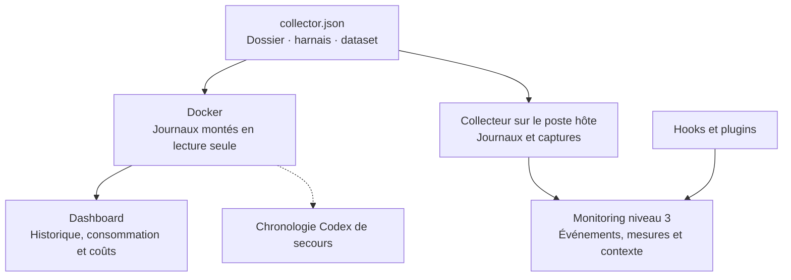

# Collecte Monitoring · niveau 3

Le récepteur local alimente **la SQLite de Burn**, dans le volume Docker existant.
Il ne lit pas la base du monitor historique et ne partage aucune base entre les
utilisateurs. Les événements d’activité et les mesures du modèle ont chacun
leur récepteur. La collecte continue et l’import manuel alimentent le détail
des sessions.

## Pipeline commun

```text
Claude Code / Codex / OpenCode
        → adaptateur de harnais
        → POST /api/monitor/events
        → transaction SQLite : événement + session + snapshot de tokens
```

L’identité d’une source est le triplet **harnais + environnement + machine**.
Les mêmes identifiants de session/événement peuvent exister sur deux machines,
dans Perso et Enterprise, ou sur deux harnais, sans fusionner leurs données.
Le fournisseur ou le nom du modèle ne sert pas à deviner l’environnement.

- Harnais : `claude`, `codex`, `opencode`.
- Environnement : `personal`, `enterprise`, `unclassified` (`accorgpt` reste accepté comme alias historique).
- Chaque adaptateur doit fournir un `event_id` stable pour les tentatives de renvoi.
- Les tokens sont des snapshots cumulatifs : dernier bilan final, sinon dernier
  provisoire. Les catégories absentes restent inconnues. Ils ne sont jamais
  additionnés aux agrégats de consommation déjà présents dans Burn.
- Les tables `monitor_sessions`, `monitor_events` et `monitor_usage` sont ajoutées
  par la migration 6 ; les tables existantes et leur historique restent conservés.

## Activation explicite

Dans `.env`, définir `MONITOR_INGEST_ENABLED=1`, puis lancer `./deploy.sh`.
La réception est **désactivée par défaut**. Aucun hook n’est installé ou redirigé
par le déploiement. Les routes Monitoring sont réservées à localhost, comme Admin.
Cette première version ne fournit pas de réception distante authentifiée.

### Contrat v1

```json
{
  "schema_version": 1,
  "event_id": "demo-event-1",
  "harness": "claude",
  "dataset": "personal",
  "machine_id": "demo-machine",
  "session_id": "demo-session",
  "type": "PostToolUse",
  "timestamp": "2026-10-11T10:00:00Z",
  "project": "demo-project",
  "ticket": "DEMO-1",
  "tool_name": "Read",
  "usage_snapshot": {
    "model": "demo-model",
    "usage": {
      "input_tokens": 100,
      "output_tokens": 20,
      "cache_creation_input_tokens": 0,
      "cache_read_input_tokens": 80
    }
  }
}
```

Types : `SessionStart`, `SessionEnd`, `PreToolUse`, `PostToolUse`,
`PostToolUseFailure`, `Stop`, `Notification`, `UserPromptSubmit`,
`SubagentStart`, `SubagentStop`, `Usage`. Un `Stop` peut fournir `final_usage`,
mais seul `SessionEnd` ferme la session. Les dates doivent préciser leur fuseau.

### Adaptateurs

`scripts/send-monitor-event.mjs` est un client commun Node 24+, lisant un événement
JSON sur stdin. Son appel doit définir explicitement `BURN_MONITOR_HARNESS` et
`BURN_MONITOR_DATASET`. `BURN_MONITOR_MACHINE` peut fournir une identité stable ;
le défaut est le hostname. `BURN_MONITOR_URL` pointe uniquement sur localhost
(défaut `http://localhost:4095/api/monitor/events` ; adapter au port installé).

Le client enlève les contenus bruts avant envoi et effectue au plus deux tentatives
avec le même ID. Une panne du récepteur ne fait pas échouer la commande du harnais.
Il n’y a pas encore de file d’attente persistante : un événement peut être perdu
si Burn est arrêté. `BURN_MONITOR_DEBUG=1` expose uniquement une erreur générique.

**Claude Code** : le payload enrichi de `send-to-monitor.ts` est accepté par
`POST /api/hook`. Il conserve les métadonnées et `usage_snapshot` / `final_usage`.
Sans environnement déclaré, les anciennes commandes sont classées
`unclassified`, jamais automatiquement Perso. L’ancien format n’a pas d’ID
stable : sa déduplication est au mieux par empreinte des métadonnées/snapshot.
Préférer le contrat v1 pour distinguer les événements identiques répétés.

Le client commun accepte aussi le JSON brut d’un hook Claude, mais **ne lit pas
le transcript** : sans enrichissement, les tokens restent inconnus.

### Collecteur natif Claude Code (Perso et Enterprise)

Le collecteur **distinct** `scripts/claude-monitor-hook.mjs` reçoit les événements
natifs selon le [contrat des hooks Claude Code](https://code.claude.com/docs/en/hooks).
Il conserve le vrai `session_id`, les IDs outil/agent et les noms MCP, skills,
commandes et scripts. Il détecte le projet depuis la racine Git (sinon le nom du
dossier courant), la branche et un ticket Jira lorsque la branche contient un
seul ticket distinct. Aucun prompt, contenu d’outil ou transcript n’est envoyé.
Il ne lit pas l’ancienne base de monitoring et ne modifie pas son script.

Depuis le clone Burn, avec **Node.js 24+ sur l’hôte** :

```bash
# Aperçu uniquement : aucune modification, aucun contenu de settings affiché.
node scripts/install-claude-monitor.mjs --dataset personal
node scripts/install-claude-monitor.mjs --dataset enterprise

# Ajouter les hooks Burn en conservant tous les réglages et hooks existants.
node scripts/install-claude-monitor.mjs --dataset personal --apply
node scripts/install-claude-monitor.mjs --dataset enterprise --apply
```

Les cibles par défaut sont `~/.claude/settings.json` et
`~/.claude-enterprise/settings.json`. Utiliser `--settings /chemin/settings.json` si le
lanceur emploie un autre dossier et `--url http://localhost:4090/api/monitor/events`
pour un autre port. **Le dataset est explicite**, pas déduit de la clé, du modèle
ou du dossier de projet. Installer chaque dataset dans le bon environnement.

L’installateur ajoute dix types d’événement, sauvegarde le fichier d’origine avec
des permissions privées et remplace atomiquement les réglages. Le répéter avec
les mêmes arguments ne crée pas de doublons. Une configuration Burn différente
déjà installée est refusée pour éviter deux collectes concurrentes. Les fichiers
de réglages liés symboliquement doivent être désignés par leur cible réelle.

**Conserver le clone Burn et le chemin Node** : les commandes installées utilisent
leurs chemins absolus. Démarrer une nouvelle session Claude Code pour charger les
hooks ; le récepteur Burn doit être activé. Pour désinstaller, enlever seulement
les entrées dont la commande contient `claude-monitor-hook.mjs`. Restaurer une
sauvegarde entière uniquement si aucun réglage n’a changé depuis.

Pour retirer uniquement les hooks Burn du dataset choisi, avec sauvegarde :

```bash
node scripts/install-claude-monitor.mjs --dataset personal --remove --apply
node scripts/install-claude-monitor.mjs --dataset enterprise --remove --apply
```

`--replace --apply` actualise les commandes Burn du même dataset (chemin Node,
clone ou port) sans modifier les autres hooks. 

Les variables `BURN_MONITOR_PROJECT`, `BURN_MONITOR_TICKET`,
`BURN_MONITOR_WORKFLOW` et `BURN_MONITOR_WORKFLOW_RUN_ID` permettent au lanceur de
transmettre un contexte explicite. Un événement enrichi peut aussi le fournir.
Les workflows ne sont pas déduits des prompts ou d’un ancien état partagé.
Les compteurs de tokens restent inconnus dans ce collecteur. Sans file persistante côté hook, une panne peut perdre un événement.

### Collecteur natif Codex

Le collecteur utilise les [hooks natifs Codex](https://learn.chatgpt.com/docs/hooks),
vérifiés sur `codex-cli 0.161.0` : sessions, appels d’outils/MCP, prompts (événement
seulement), agents, interruptions et compactage. Il ne lit pas les transcripts ;
les tokens et les détails absents du hook restent inconnus. Il n’analyse pas le
texte d’une réponse outil pour deviner son statut.

```bash
node scripts/install-codex-monitor.mjs --dataset personal --apply
node scripts/install-codex-monitor.mjs --dataset enterprise --apply
```

Cibles : `~/.codex/hooks.json` et `~/.codex-enterprise/hooks.json`. `--settings` et
`--url` permettent des surcharges ; `--replace` et `--remove` ont la même
sémantique de sauvegarde/retrait limité que Claude. Le `CODEX_HOME` du lanceur
doit correspondre à la cible. Les commandes n’émettent ni décision ni contexte
vers Codex, et respectent le timeout de trois secondes de SessionEnd.

**L’installation ne valide pas les hooks à votre place.** Dans chaque
environnement Codex, ouvrir `/hooks` **dans le CLI** et approuver les nouveaux hooks Burn ; ils
sont ignorés tant qu’ils ne sont pas approuvés. Garder `features.hooks` activé.
Toute modification de la commande peut demander une nouvelle validation. Aucun
flag de contournement ni règle de confiance gérée n’est installé. Une politique
administrateur peut empêcher la collecte locale.

### Plugin OpenCode 2

Le plugin suit l’[API OpenCode 2](https://opencode.ai/v2/docs/build/plugins),
vérifiée sur **2.0.25**. Il observe les opérations natives et le flux public des
nouveaux événements : outils, erreurs, shell, skills, sessions, sous-agents,
interruptions et snapshots cumulatifs de tokens disponibles. Il ne parcourt ni
les sessions historiques ni les messages/prompts. Il n’écrit jamais dans les
arguments, résultats ou décisions des hooks natifs.

```bash
node scripts/install-opencode-monitor.mjs --datasets personal,enterprise --apply
# Enterprise seulement
node scripts/install-opencode-monitor.mjs --datasets enterprise --apply
# Retirer uniquement le plugin Burn
node scripts/install-opencode-monitor.mjs --datasets '' --apply
```

Le plugin est référencé dans la clé `plugins` de la configuration globale
`~/.config/opencode/opencode.json` (surcharge `--config`). Les autres réglages,
fournisseurs et plugins restent conservés ; sauvegarde privée avant modification.
Seuls les documents JSON sont pris en charge par l’installateur : un fichier
JSONC doit être configuré manuellement pour préserver ses commentaires.
Conserver le clone Burn, puis **recharger OpenCode** lorsque le travail en cours
le permet. Le script ne redémarre pas son service automatiquement. La version 1
d’OpenCode n’est pas couverte par ce plugin.

La base OpenCode étant partagée, **le fournisseur réel de la session** distingue
les datasets : les identifiants listés dans `ENTERPRISE_OPENCODE_PROVIDERS` (aucun par défaut) pour Enterprise ; `openai`, `chatgpt`,
`anthropic`, `opencode`, `opencode-go`, `github-copilot`, `openrouter` pour Perso.
Un fournisseur inconnu ou déclaré dans les deux groupes est ignoré. Un mapping
personnalisé est possible dans les options du plugin :

```json
{
  "providers": {
    "personal": ["openai", "anthropic"],
    "enterprise": ["my-enterprise-provider"]
  }
}
```

Chaque instance ignore les événements des autres emplacements. Aucun replay
n’est demandé au flux public. Les snapshots restent provisoires, les caches ne
sont pas ajoutés une seconde fois ; les snapshots d’agents sont exclus du bilan
parent. Si un changement Perso/Enterprise est observé dans une même session, ses
nouveaux snapshots cumulatifs sont ignorés car ils ne peuvent pas être séparés.
Les agents/commandes/MCP ne sont identifiés que lorsque le harnais fournit leurs
métadonnées. Les workflows demandent toujours un contexte explicite.
Le format OpenCode sépare les tokens de raisonnement : ils sont inclus dans la
catégorie output du snapshot Burn lorsqu’ils sont connus ; sinon output reste
inconnu. Le total respecte les catégories natives, sans estimation de coût.

La collecte est non bloquante : erreurs isolées, 128 transmissions simultanées
maximum, contexte borné à 4096 sessions par instance. Un événement peut être
perdu lors d’une panne, d’un déchargement ou d’une saturation ; aucun spool natif
persistant n’est encore fourni.

## Consultation technique

- `GET /api/monitor?range=all&project=...&ticket=...&machine=...&source=...`
  retourne des sessions paginées (50), leur résumé et les filtres disponibles.
- `range=custom&from=YYYY-MM-DD&to=YYYY-MM-DD` filtre la date UTC de démarrage.
- `GET /api/monitor/session?source=...&id=...` retourne les métadonnées, le
  nombre total d’événements et une page d’événements. Les paramètres `offset`
  et `limit` permettent de consulter la chronologie. La limite par défaut est 500.
- Les listes de sessions et d’échanges acceptent aussi `fromTime` et `toTime`
  avec un fuseau explicite. Monitoring affiche la dernière heure par défaut
  et permet de choisir une plage horaire ou tout l’historique.

Les filtres et requêtes ne déclenchent aucune collecte. Prompts, réponses,
arguments/sorties d’outils, chemins de transcripts et payloads bruts ne sont pas
stockés. Les données de test sont fictives et créées dans des fichiers temporaires.
Les événements/session sont conservés sans purge automatique dans ce premier lot.

## Dimensions d’activité

Les événements conservent projet, branche, ticket Jira, tool/parent IDs, nom CLI,
serveur/outil MCP, nom de skill, agent/parent/modèle et nom/ID de run de workflow.
La machine sert à qualifier l’identité, pas à produire un indicateur utilisateur
principal. Scripts et commandes Bash gardent seulement le nom de l’exécutable
et du script, sans arguments, secrets ou corps de script. Les commandes shell
complexes non reconnues restent non identifiées.

`GET /api/monitor` fournit aussi `metrics` : événements par type, outils, MCP,
CLI, commandes, scripts, skills, workflows et agents. Les paires Pre/Post d’un
même `tool_use_id` comptent **une invocation**, avec son état terminé/en échec.
Les événements sans cet ID sont signalés dans la couverture, sans inventer
leur appariement. Les runs de workflow sont distincts par ID de run ; les agents
sont identifiés par ID d’agent ou lien vers le parent. Les observations sans
identité suffisante sont signalées séparément. Les bilans de tokens restent
ceux des sessions : aucun coût par outil n’est attribué sans mesure explicite.

Un bilan attaché à un agent identifié ou à un événement Subagent reste dans
les métadonnées de cet événement avec `usageScope=agent` ; il ne remplace pas
le bilan de la session parente. Les coûts/tokens parent et enfant ne sont pas
additionnés sans établir leur couverture respective.

## Réception d’échanges API (compatibilité)

`POST /api/monitor/requests` accepte les échanges API version 1 des datasets
`personal` et `enterprise` (`accorgpt` reste un alias Enterprise). Le récepteur
stocke les métadonnées et compteurs `usage` dans `monitor_requests`, sans les
prompts ni les réponses. Le schéma **8** conserve les échanges historiques dans
`enterprise` et déduplique les renvois par dataset, machine et `request_id`.
`GET /api/monitor/requests` expose les deux environnements par défaut, paginés
par 50. Le paramètre `dataset` limite la liste et son résumé à un environnement.
Aucun émetteur n’est fourni par ce dépôt. Le récepteur conserve la protection
localhost et l’activation `MONITOR_INGEST_ENABLED=1` des événements de hooks.

## Découverte et activation dans l’interface

Monitoring reste accessible dans la navigation. Sans événement ni échange,
la page présente un aperçu explicitement illustratif, les bénéfices du niveau 3
et les étapes de configuration. Le récepteur activé sans données est distingué
de la configuration manquante. Dès la première réception, la vue affiche les
compteurs observés et les dernières sessions/requêtes ; elle se relit chaque
minute lorsque l’onglet est visible. Les aperçus ne contiennent aucune métrique
fictive présentée comme réelle. Admin et Help expliquent les niveaux 1/2/3.

Les boutons conduisent à Admin et au guide. Ils ne modifient pas automatiquement
les montages de journaux ni les hooks. Les niveaux 2 et 3 demandent encore les
réglages du déploiement et des harnais décrits dans ces guides.

### Mesures du modèle et contenu du contexte

Le détail d’une session affiche les mesures importées par le récepteur local
`/api/monitor/model-requests`. La migration SQLite 9 ajoute ces mesures sans
les additionner aux agrégats de consommation existants.

#### Configuration du niveau 3 par harnais

**Sur quoi repose la collecte.** Les hooks et plugins décrivent l’activité.
Les journaux et bases des harnais fournissent les compteurs du modèle. Les
captures ajoutent le détail du contexte quand le harnais l’expose.



| Harnais | Activité | Compteurs du modèle | Détail du contexte |
| --- | --- | --- | --- |
| Claude Code | Hooks du profil | `claudeLogs` | Capture native des requêtes et réponses |
| Codex | Hooks approuvés dans le CLI ou journal local en secours | `codexLogs` | Éléments observables dans le journal |
| OpenCode 2 | Plugin Burn | Messages assistant terminés dans `openCodeDb` | Résumé HTTP ou trame WebSocket sortante via le plugin |

Pour les agents orchestrés par Paperclip, consultez la
[couverture par harnais](#paperclip--couverture-par-harnais).

##### Installation guidée sur macOS

Depuis le dépôt IA Burn avec Node.js 24 ou plus récent, affichez l’aperçu.
Le script indique chaque fichier et colore ses messages dans le terminal.

```bash
node scripts/install-monitoring.mjs --claude --codex --deploy
```

Relancez avec `--apply` pour préparer les journaux Claude et Codex, la capture
Claude, les hooks et le service `launchd`. `--deploy` active le récepteur dans
`.env` et le redéploie. `--port` permet de choisir le port. Par défaut, le
script reprend celui du récepteur existant ou utilise `4095`.

Pour un autre emplacement, donnez le dossier du profil Claude ou Codex. Lancez
une commande par dataset. Chaque option de profil peut être répétée dans la même
commande. Exemple avec deux profils entreprise et un deuxième profil Claude.

```bash
node scripts/install-monitoring.mjs --dataset enterprise \
  --claude-profile ~/.claude-accor --claude-profile ~/.claude-autre \
  --codex-profile ~/.codex-accor
```

Pour migrer des hooks Burn d’un ancien clone, ajoutez `--replace-hooks` à
l’aperçu. Avec `--apply`, le script sauvegarde le fichier et remplace les
entrées IA Burn du dataset choisi. Pour `enterprise`, il reprend aussi les
entrées enregistrées sous l’ancien nom `accorgpt`. Approuvez les hooks Codex modifiés dans
`/hooks`. L’installateur reprend le collecteur existant et ses sources. Pour
ajouter OpenCode ou Paperclip, utilisez les procédures dédiées ci-dessous.

##### Profils partagés avec Docker

Sur le poste hôte, déclarez les dossiers dans `claudeLogs` et `codexLogs`,
avec leurs datasets. Docker utilise ce même fichier pour préparer ses montages
en lecture seule. Pour OpenCode, `openCodeDb` peut aussi fournir le chemin absolu
de la base `opencode.db`. Le dossier est monté pour rendre son journal WAL
accessible. Le collecteur hôte et Docker exécutent chacun leur propre lecture.

```bash
./deploy.sh --port 4095 --profiles ~/.local/state/ia-burn/collector.json --check
./deploy.sh --port 4095 --profiles ~/.local/state/ia-burn/collector.json
```

Si le fichier contient plusieurs dossiers pour un couple harnais et dataset,
le montage principal garde son dossier actuel lorsqu’il figure dans la liste.
Sinon, le premier dossier déclaré devient le montage principal. Les autres
alimentent la consommation et le secours Codex. Les quotas personnels utilisent
le montage principal. Pour un couple absent du fichier, Docker reprend la
configuration `.env` ou le chemin par défaut.

Pour revenir aux montages précédents, redéployez sans `--profiles`. Le volume
SQLite reste en place. Si vous avez aussi modifié la liste des sources du
collecteur hôte, restaurez sa configuration sauvegardée et relancez le service.

```bash
./deploy.sh --port 4095
```

##### Préparation commune

**Où.** Dépôt IA Burn → `.env`. Ajoutez cette ligne.

```dotenv
MONITOR_INGEST_ENABLED=1
```

Depuis le dépôt, déployez Burn sur le port choisi. Les exemples suivants
utilisent le port `4095` et Node.js 24+ sur le poste qui exécute les harnais.

```bash
./deploy.sh --port 4095
```

##### Collecteur commun sur le poste

**Où.** Créez `~/.local/state/ia-burn/collector.json` sur le poste hôte. `~`
désigne le dossier personnel du compte qui lance le collecteur. Le collecteur
lit ce fichier et envoie les mesures au conteneur IA Burn via l’adresse HTTP
`receiver`. Renseignez `receiver` et `since`, puis ajoutez les clés des harnais
utilisés.

Le collecteur recherche les nouvelles mesures toutes les 15 secondes. Il
reprend les captures Claude en attente, puis lit les journaux Claude et Codex
ainsi que la base OpenCode. La lecture de ces journaux et de la base commence à
la date `since`.

Le fichier de configuration accepte les propriétés suivantes.

| Propriété | Valeur |
| --- | --- |
| `receiver` | Récepteur HTTP local, par exemple `http://127.0.0.1:4095/api/monitor/model-requests` |
| `since` | Date d’activation ISO 8601 |
| `claudeLogs`, `codexLogs` | Listes d’objets avec `directory` et `dataset`. Pour Claude, `billing` est facultatif. |
| `claudeCaptures` | Liste d’objets avec `directory`, `dataset`, éventuellement `billing`, et `paperclip: true` pour un répertoire dédié |
| `paperclip`, `paperclipDatasets` | URL locale de l’API se terminant par `/api/`, puis correspondance facultative entre identifiants de sociétés et datasets |
| `openCodeDb`, `openCodeProviders` | Chemin vers `opencode.db`, puis correspondance entre identifiants de fournisseurs et datasets |
| `openCodeCapture` | Répertoire privé partagé avec l’option `captureDirectory` du plugin OpenCode |

Exemple de `~/.local/state/ia-burn/collector.json` sur macOS. Remplacez
`/Users/alice` par le chemin de votre compte et `since` par votre date de départ.
Gardez les entrées correspondant aux harnais et profils que vous utilisez.

```json
{
  "receiver": "http://127.0.0.1:4095/api/monitor/model-requests",
  "since": "2026-11-07T20:00:00Z",
  "claudeLogs": [
    { "directory": "/Users/alice/.claude", "dataset": "personal" }
  ],
  "claudeCaptures": [
    { "directory": "/Users/alice/.local/state/ia-burn/claude-capture/direct", "dataset": "personal" },
    { "directory": "/Users/alice/.local/state/ia-burn/claude-capture/paperclip", "dataset": "personal", "paperclip": true }
  ],
  "paperclip": "http://127.0.0.1:3100/api/",
  "codexLogs": [
    { "directory": "/Users/alice/.codex", "dataset": "personal" }
  ],
  "openCodeDb": "/Users/alice/.local/share/opencode/opencode.db",
  "openCodeProviders": { "openai": "personal", "deepseek": "personal" },
  "openCodeCapture": "/Users/alice/.local/state/ia-burn/opencode-capture"
}
```

Le déploiement Docker démarre le récepteur. Pour un premier essai du collecteur,
exécutez cette commande au premier plan depuis le dépôt sur le poste hôte.

```bash
node scripts/collect-model-requests.mjs ~/.local/state/ia-burn/collector.json
```

Pour la collecte continue, configurez un service utilisateur. Sur macOS,
`launchd` lance le collecteur à la connexion avec `RunAtLoad` et le relance
avec `KeepAlive`. Utilisez les chemins absolus de Node, du script et de la
configuration dans `ProgramArguments`. Une fois le service chargé, il exécute
la commande automatiquement. Redémarrez le service après chaque modification
de `collector.json`.

##### Claude Code en direct

**Sur quoi repose la collecte.** Les hooks remontent les événements, le journal
fournit les compteurs et la capture native décrit le contexte des requêtes.

1. **Terminal → dépôt IA Burn.** [Installez les hooks Claude Code](#collecteur-natif-claude-code-perso-et-enterprise).
   Cette commande ajoute les entrées Burn dans `~/.claude/settings.json` → `hooks`.
   Utilisez `--settings /chemin/du/profil/settings.json` pour cibler un autre profil.

   ```bash
   node scripts/install-claude-monitor.mjs --dataset personal --apply
   ```

   Pour configurer uniquement le démarrage de session à la main, ajoutez cet
   objet à la liste `hooks.SessionStart` dans `~/.claude/settings.json`.
   Créez la liste si elle manque ou conservez ses entrées si elle existe.
   Adaptez les deux chemins absolus, le dataset et le port. L’installateur
   configure les dix événements Burn.

   ```json
   {
     "matcher": "*",
     "hooks": [
       {
         "type": "command",
         "command": "'/opt/homebrew/bin/node' '/Users/alice/dev/ia-burn-dashboard/scripts/claude-monitor-hook.mjs' '--dataset' 'personal' '--url' 'http://localhost:4095/api/monitor/events'",
         "timeout": 5
       }
     ]
   }
   ```

2. **Profil Claude Code → `settings.json` → `env`.** Créez un dossier de mode
   `0700`. Fusionnez les trois variables ci-dessous avec celles déjà présentes
   et utilisez un chemin absolu.

   ```json
   {
     "env": {
       "CLAUDE_CODE_ENABLE_TELEMETRY": "1",
       "OTEL_LOGS_EXPORTER": "console",
       "OTEL_LOG_RAW_API_BODIES": "file:/Users/alice/.local/state/ia-burn/claude-capture/direct"
     }
   }
   ```

3. **`collector.json`.** Ajoutez la racine du profil (`CLAUDE_CONFIG_DIR` ou
   `~/.claude`) à **`claudeLogs`** et le dossier privé à **`claudeCaptures`**.
   Utilisez un dossier de capture distinct par dataset. Ouvrez une nouvelle
   session. L’import lit l’index natif, disponible depuis Claude Code 2.1.274.
   [Capture native Claude Code](https://code.claude.com/docs/en/monitoring-usage#api-response-body-event).

##### Paperclip · Couverture par harnais

Paperclip orchestre les agents. Sur le même poste, Burn collecte les mesures
dans les sources du harnais réellement utilisé par chaque agent.

| Adaptateur Paperclip | Source pour Burn | Rattachement à l’exécution et au ticket |
| --- | --- | --- |
| Claude Code local via ACP | Capture native via le lanceur ci-dessous, ou journal Claude | Vérifié de bout en bout avec la capture native |
| Codex local | Journaux de la racine `CODEX_HOME` effective | Tenté à partir du journal, à valider de bout en bout |
| OpenCode local avec OpenCode 2 | Base et plugin du profil de l’agent | Tenté pour les captures du plugin, à valider de bout en bout. Les compteurs lus dans la base restent associés à la session OpenCode. |
| Gemini, Cursor, Pi, Grok, Kimi, Hermes, OpenClaw et agents distants | Aucune source Paperclip intégrée au niveau 3 | Indisponible |

Pour le rattachement, `paperclip` doit pointer vers l’API locale. Le collecteur
cherche une exécution dont l’identifiant de session et la fenêtre horaire
correspondent à la mesure. Il renseigne l’exécution et le ticket lorsqu’il
trouve une correspondance unique.

###### Claude Code local via ACP

1. **Terminal du poste Paperclip.** Créez le dossier privé du compte qui lance
   l’agent. Le lanceur macOS utilise Node et le binaire `~/.local/bin/claude`.

   ```bash
   mkdir -p -m 700 ~/.local/state/ia-burn/claude-capture/paperclip
   ```

2. **Paperclip → Agents → votre agent → Secrets & variables → Environment variables.**
   Cliquez sur **Add variable**, renseignez les deux champs, puis cliquez sur **Save**.

   | Champ | Valeur |
   | --- | --- |
   | Nom | **`CLAUDE_CODE_EXECUTABLE`** |
   | Valeur | Chemin absolu du lanceur, par exemple `/Users/alice/dev/ia-burn-dashboard/scripts/claude-paperclip-capture.mjs` |

3. **`collector.json`.** Ajoutez l’entrée à la liste existante **`claudeCaptures`**
   et adaptez le port de l’API **`paperclip`**.

   ```json
   {
     "claudeCaptures": [
       { "directory": "/Users/alice/.local/state/ia-burn/claude-capture/paperclip", "dataset": "personal", "paperclip": true }
     ],
     "paperclip": "http://127.0.0.1:3100/api/"
   }
   ```

   Si plusieurs sociétés utilisent des datasets différents, renseignez
   `paperclipDatasets` avec leur UUID comme clé et `personal` ou `enterprise`
   comme valeur.

###### Codex local dans Paperclip

1. **Paperclip → Agents → votre agent → Secrets & variables → Environment variables.**
   Relevez la valeur de `CODEX_HOME` si elle est renseignée. Sinon, cherchez le
   dossier `codex-home` géré par l’agent, par exemple
   `~/.paperclip/instances/<instance>/companies/<société>/agents/<agent>/codex-home`.
2. **`collector.json` → `codexLogs`.** Ajoutez le chemin absolu de cette racine
   avec le dataset voulu. Burn doit pouvoir lire ses journaux `sessions` et
   `archived_sessions`. Voir l’[exemple Codex](#codex).

###### OpenCode local dans Paperclip

1. **Paperclip → Agents → votre agent → Harness / Runtime.** Vérifiez que
   l’agent utilise OpenCode 2. Dans **Secrets & variables → Environment variables**,
   relevez `XDG_CONFIG_HOME` et `XDG_DATA_HOME` s’ils sont définis.
2. **Profil global de l’agent → `opencode.json` → `plugins`.** Suivez la
   [procédure OpenCode 2](#opencode-2). Si le profil est personnalisé, passez
   son chemin à l’installateur avec **`--config`**.
3. **`collector.json`.** Renseignez **`openCodeDb`** avec la base utilisée par
   l’agent, **`openCodeProviders`** avec ses fournisseurs et **`openCodeCapture`**
   avec le dossier déclaré dans le plugin. Burn doit pouvoir lire ces fichiers.

##### Codex

**Sur quoi repose la collecte.** Les journaux `sessions` et `archived_sessions`
fournissent les compteurs et le contexte journalisé. Le corps de la requête au
modèle et les schémas d’outils restent indisponibles dans ces journaux.

1. **`collector.json` → `codexLogs`.** Ajoutez chaque racine `CODEX_HOME` avec
   son dataset. Exemple pour un profil personnel.

   ```json
   {
     "codexLogs": [
       { "directory": "/Users/alice/.codex", "dataset": "personal" }
     ]
   }
   ```

2. **Terminal → dépôt IA Burn, puis CLI Codex → `/hooks`.** Pour les événements
   en direct, [installez et approuvez les hooks Codex](#collecteur-natif-codex).
   Quand aucun événement de hook n’a été reçu, le backend peut reconstruire
   la chronologie si le dossier Codex est monté en lecture seule.

##### OpenCode 2

**Sur quoi repose la collecte.** La base locale fournit les compteurs des
messages assistant terminés. Le plugin fournit les événements et, lorsque la
capture est activée, le résumé du contexte des requêtes.

1. **Terminal → dépôt IA Burn.** [Installez le plugin OpenCode](#plugin-opencode-2).
   L’installateur ajoute une entrée dans `~/.config/opencode/opencode.json` → `plugins`.
2. **`opencode.json` → `plugins` → entrée Burn → `options`.** Créez un dossier
   de mode `0700`. Conservez les options `datasets` et `url` installées et
   ajoutez **`captureDirectory`** et **`providers`**. Exemple avec DeepSeek.

   ```json
   {
     "captureDirectory": "/Users/alice/.local/state/ia-burn/opencode-capture",
     "providers": { "personal": ["openai", "deepseek"], "enterprise": [] }
   }
   ```

3. **`collector.json`.** Renseignez **`openCodeDb`**, **`openCodeProviders`**
   et **`openCodeCapture`**. Utilisez les identifiants OpenCode comme clés du
   mapping et le même dossier que `captureDirectory`.

   ```json
   {
     "openCodeDb": "/Users/alice/.local/share/opencode/opencode.db",
     "openCodeProviders": { "deepseek": "personal" },
     "openCodeCapture": "/Users/alice/.local/state/ia-burn/opencode-capture"
   }
   ```

4. Rechargez OpenCode. Le plugin résume les requêtes HTTP et les trames
   WebSocket sortantes qu’il observe. Une trame peut porter uniquement le
   contexte ajouté depuis l’appel précédent. Les compteurs des messages
   assistant et le contexte des requêtes sont affichés séparément.

Lancez une courte session, puis ouvrez **Monitoring → Sessions avec mesures**.
Vérifiez le harnais, le dataset et la provenance de la mesure dans le détail.

##### Conservation des journaux et captures

| Données | Suppression automatique par IA Burn |
| --- | --- |
| Journaux de session Claude Code et Codex, base OpenCode | Lecture seule. Leur durée de conservation dépend de leur harnais. |
| Captures brutes Claude Code, y compris celles des agents Paperclip | La paire `.request.json` / `.response.json` est supprimée après confirmation de l’import et sauvegarde de la progression. Les captures en attente ou rejetées restent sur disque. |
| Index de capture Claude Code `index.jsonl` | Conservé. IA Burn mémorise sa position de lecture dans `collector-state.json`. |
| Résumés OpenCode en attente | Supprimés après confirmation de l’import. Si l’envoi échoue, le fichier reste en attente. |
| Événements et mesures importés dans SQLite | Conservés sans purge automatique au niveau 3. |

#### Import manuel

L’importeur Node accepte trois formats. Le dataset doit être explicite.

```bash
node scripts/import-model-requests.mjs --claude-dir /chemin/capture --dataset personal --provider anthropic --billing subscription
node scripts/import-model-requests.mjs --codex-log /chemin/rollout.jsonl --dataset personal
node scripts/import-model-requests.mjs --opencode-db /chemin/opencode.db --session ID --dataset personal
```

- **Claude Code** lit l’index natif et les paires de fichiers requête/réponse.
  Activer la capture sur l’exécution à mesurer avec
  `CLAUDE_CODE_ENABLE_TELEMETRY=1`, `OTEL_LOGS_EXPORTER=console` et
  `OTEL_LOG_RAW_API_BODIES=file:/chemin/capture`. Choisir un répertoire privé.
  L’option `--skills-dir` permet de comparer le contenu injecté aux fichiers
  source du répertoire explicitement sélectionné. Sans correspondance vérifiée,
  le détail indique que l’étendue du contenu est inconnue.
- **Codex** lit les compteurs par appel et les éléments visibles dans le journal
  sélectionné : catalogue de skills (nom et description), appels et résultats
  d’outils ou de MCP, et blocs `AGENTS.md` reconnus. Avec `--skills-dir`,
  un résultat qui correspond intégralement au fichier source approuvé est
  identifié comme tel. L’activité est rattachée à la fenêtre entre deux compteurs
  du même tour. Le journal ne fournit pas la requête complète ni les schémas.
  Réimporter avec les mêmes métadonnées complète un ancien import sans contexte.
- **OpenCode 2** lit les compteurs des messages assistant terminés dans la base
  sélectionnée, en lecture seule.
- Pour comparer plusieurs exécutions, passer le même identifiant de tâche
  explicite via `--task`, par exemple l’UUID Paperclip ou une référence GitLab
  incluant le projet. `--run`, `--orchestrator`, `--provider`, `--gateway`
  et `--billing` complètent l’attribution. Pour Claude, préciser `--session`
  avec `--task` ou `--run`. Le récepteur par défaut écoute sur localhost:4095.
  Utiliser `--url` pour un autre port et `--machine` si les hooks utilisent
  un identifiant de machine personnalisé.

Burn conserve les noms, les descriptions de skills, les tailles et les compteurs.
Les prompts complets, les corps de fichiers et les résultats d’outils restent
dans les fichiers de capture locaux. Les estimations par bloc utilisent
quatre octets par jeton et peuvent se recouvrir avec un bloc parent. Les champs
absents restent inconnus et les mesures conservent leur niveau d’observation
(appel, message assistant ou tour).
